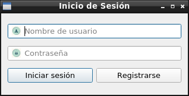
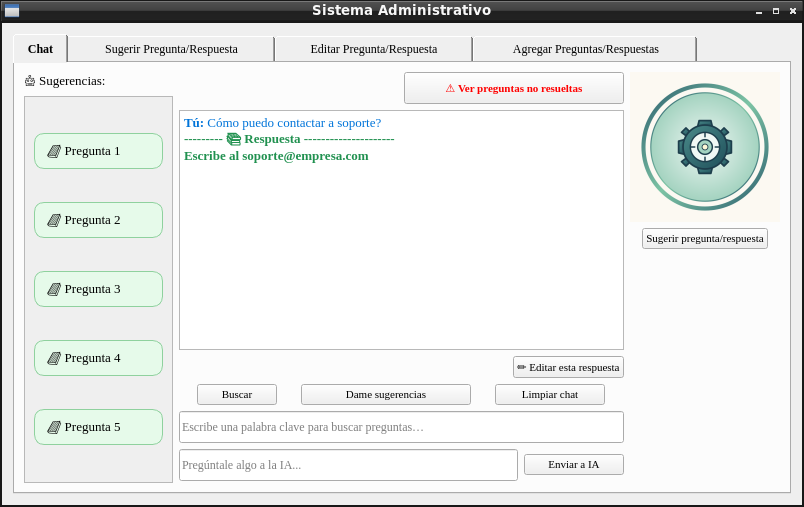
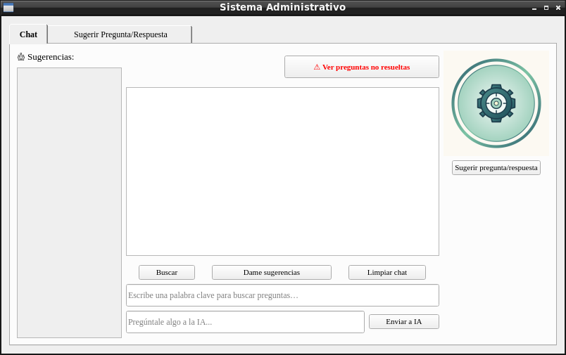
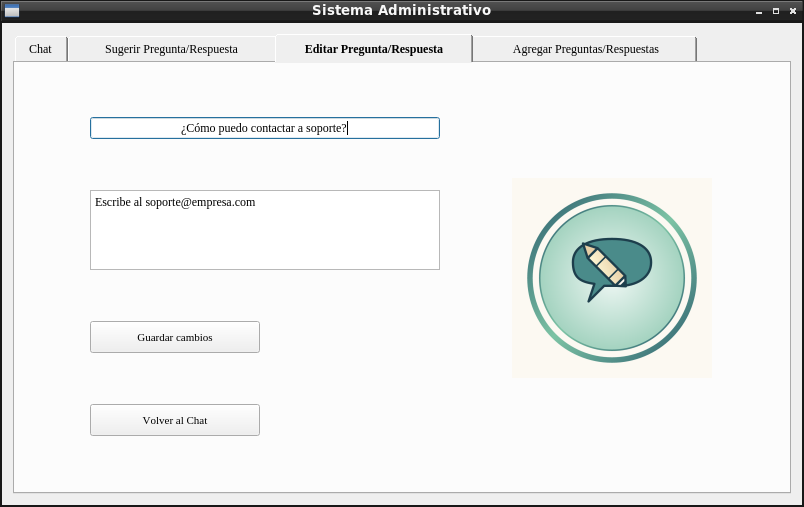

# 🤖 Sistema Administrativo con Chatbot IA (PySide2)

Un sistema de escritorio interactivo y modular desarrollado en Python utilizando PySide2. Este proyecto integra un chatbot inteligente potenciado por modelos de lenguaje avanzados (vía OpenAI u OpenRouter), un sistema de gestión de base de datos local SQLite y un control riguroso de roles de usuario (Administrador y Empleado).

---

### 📌 Notas Importantes
* Este proyecto utiliza PySide2 (LGPL-3.0), OpenAI y bcrypt (Apache 2.0), rapidfuzz (MIT) y python-dotenv (BSD-3-Clause). Consulta el archivo NOTICE.md y el directorio LICENSES/ para más detalles.

---

## 📸 Capturas de pantalla

### Login


### Chat Administrador


### Chat Empleado


### Pestaña Editar Pregunta--Respuesta



---

## ✨ Características Principales

* **Interfaz Gráfica (PySide2):** Interfaz limpia estructurada en pestañas con diseño optimizado (fuentes personalizadas, logotipos y paneles interactivos).
* **Control de Acceso y Roles (Login):** Autenticación de usuarios con diferenciación de privilegios:
  * *Empleados:* Pueden chatear, consultar sugerencias frecuentes y proponer nuevas preguntas/respuestas.
  * *Administradores:* Tienen acceso total para agregar, editar y administrar la base de conocimientos oficial.
* **Base de Datos Local (SQLite):** Información rápida e interna mediante archivos locales.
* **Sugerencias Dinámicas y Búsqueda Inteligente:** Búsqueda en tiempo real por palabras clave o generación de sugerencias aleatorias basadas en el historial.
* **Procesamiento Asíncrono (`IAWorker`):** Consultas a la IA ejecutadas en hilos independientes (`QThread`) para evitar congelamientos en la interfaz gráfica.
* **Gestión de Preguntas No Resueltas:** Sistema de respaldo que registra automáticamente consultas que la IA no pudo responder de forma directa para su posterior revisión administrativa.

---

## 🛠️ Tecnologías y Librerías Utilizadas

* **Python** 3.10+
* **PySide2** (Interfaz gráfica de escritorio)
* **OpenAI Python SDK** (Comunicación con modelos de lenguaje)
* **python-dotenv** (Gestión segura de variables de entorno)
* **rapidfuzz** (Coincidencia difusa de texto para sugerencias y NLP)
* **bcrypt** (Hash seguro de contraseñas)
* **SQLite3** (Base de datos)

---

## 🔒 Consideraciones de Seguridad (Datos Sensibles)

Este proyecto maneja credenciales privadas (como tu llave de API de OpenAI u OpenRouter). Para evitar filtraciones accidentales en GitHub:
1. Nunca subas tus claves directamente en el código fuente.
2. Utiliza siempre un archivo `.env` local para tus credenciales.
3. El archivo `.env` está protegido por el archivo `.gitignore` preconfigurado en este repositorio.

---

## ⚙️ Requisitos e Instalación

Sigue estos pasos para clonar y poner en marcha el proyecto en tu máquina local:

### 1. Clona el repositorio
```bash
git clone https://github.com/SRRR999/Chatbot-Python-Intranet
cd Chatbot-Python-Intranet
```

### 2. Crea y activa un entorno virtual
```bash
python -m venv venv
```


#### En Windows:
```bash
venv\Scripts\activate
```

#### En macOS / Linux:
```bash
source venv/bin/activate
```

### 3. Instala las dependencias
Instala los paquetes necesarios ejecutando el siguiente comando:

```bash
pip install -r requirements.txt
```

### 4. Configura tus variables de entorno
Crea un archivo llamado exactamente .env en la raíz del proyecto y añade tus credenciales basándote en la siguiente estructura:

```env
OPENAI_API_KEY=tu_clave
OPENAI_BASE_URL=https://openrouter.ai/api/v1
OPENAI_MODEL=deepseek/deepseek-r1:free
```
---

## Personalización de Logos e Iconos 🎨

Puedes cambiar fácilmente la identidad visual de tu chatbot:
1. Reemplaza los archivos de imagen ubicados en `icon/` por tus propios logos.
2. Asegúrate de mantener los mismos nombres de archivo o actualiza las rutas en el archivo de configuración (config.py).


### 🚀 Uso de la Aplicación

Una vez configurado el entorno y tus llaves de acceso, ejecuta el archivo principal de la interfaz gráfica:

```bash
python main.py
```
---

### 📂 Estructura del Proyecto

📦 Chatbot-Python-Intranet/

├── 📁 icon/                 # Recursos gráficos (logotipos e iconos de pestañas)

├── 📁 LICENSES/             # Textos de licencias

├── 📄 .env.example          # Variables de entorno y llaves privadas (base exacta para el .env personalizado)

├── 📄 .gitignore            # Archivos y carpetas ignorados por control de versiones

├── 📄 admin_actions.py      # Lógica administrativa: editar y agregar Q&A

├── 📄 chat_actions.py       # Lógica del chat: envío a IA, sugerencias, respuestas

├── 📄 chatbot_gui.py        # Ventana principal y control de pestañas (PySide2)

├── 📄 config.py             # Cargador de configuraciones y variables de entorno

├── 📄 db_helpers.py         # Conexión, esquemas y operaciones con SQLite

├── 📄 dialogs.py            # ventanas de login y registro.

├── 📄 ia_helpers.py         # Construcción de prompts y gestión del hilo de IA (QThread)

├── 📄 LICENSE               # Licencia del proyecto

├── 📄 main.py               # punto de entrada.

├── 📄 NOTICE                # Avisos y licencias de terceros

├── 📄 password.py           # Hash y verificación de contraseñas (bcrypt)

├── 📄 README.md             # Documentación oficial del proyecto

├── 📄 requirements.txt      # Dependencias del proyecto

└── 📄 utils.py              # Funciones auxiliares para archivos de preguntas no resueltas

---

## 🎨 Agradecimientos y Recursos

* Créditos a los autores de los iconos:
  * chatbot.png: Diseñado por [ppanggm](https://www.magnific.com/es/autor/ppanggm/iconos)
  * burbuja-de-chat.png --- edicion-chat.png --- sugerencia-chat.png: Diseñados por [Prabowo747](https://www.magnific.com/es/autor/prabowo747/iconos)
  * usuario.png: Diseñado por [Rukanicon](https://www.magnific.com/es/autor/rukanicon/iconos)
  * password.png: Diseñado por [DinosoftLabs](https://icon-icons.com/authors/452-dinosoftlabs) en [Icon-Icons](https://icon-icons.com)

---

### 🤝 Contribuciones
Actualmente no se aceptan contribuciones externas.
---

## 📌 Estado del proyecto
Versión estable **v1.0.0**. Proyecto de portafolio, no pensado para producción.
Pueden existir bugs menores; se corrigen en parches posteriores (`v1.0.1`, etc.).
Sin mantenimiento activo.

---
### 📄 Licencia
Este proyecto se distribuye bajo los términos de la licencia MIT.
